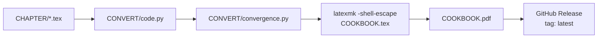

<div align="center">

# Constitutive Modelling Cookbook

**From equations to working code — a hands-on reference for the numerical implementation of constitutive models.**

[](https://github.com/TLCFEM/constitutive-modelling-cookbook/actions/workflows/pdf.yml)
[](https://github.com/TLCFEM/constitutive-modelling-cookbook/releases/latest)
[](LICENSE)
[](https://www.latex-project.org/)
[](dockerfile)

<a href="https://github.com/TLCFEM/constitutive-modelling-cookbook/releases/download/latest/COOKBOOK.pdf"><b>📥 Download the latest PDF</b></a>
&nbsp;•&nbsp;
<a href="#-what-is-inside">📚 Browse the contents</a>
&nbsp;•&nbsp;
<a href="https://github.com/TLCFEM/constitutive-modelling-cookbook/issues">🐛 Report an issue</a>

</div>

---

> [!WARNING]
> **Work in progress.**
> This book is under active development and may contain errors.
> Feedback, corrections, and suggestions are very welcome.

## ✨ What is this?

Most monographs present constitutive models only analytically, leaving the implementation, arguably the hardest part, to the reader.
This book closes that gap.

For each model it derives the theory, states the integration algorithm in pseudo code, and provides a concrete `C++` implementation taken from the open-source finite element framework [**suanPan**](https://github.com/TLCFEM/suanPan).

- **Theory-first, implementation-focused** — every formulation is carried through to a working algorithm.
- **Self-contained** — the book bundles the prerequisite tensor algebra and plasticity fundamentals.
- **Practical** — convergence safeguards, algorithmic tangent stiffness, and numerical gotchas are discussed, not hidden.
- **Portable** — algorithms are language-agnostic; you are free to implement them anywhere.

**At a glance:** 14 chapters · 30+ models · 17 algorithm listings · 58 `C++` code listings · 110 references · one `latexmk` command.

## 📖 Read it

| | |
|---|---|
| **📥 Latest PDF** | [Download `COOKBOOK.pdf`](https://github.com/TLCFEM/constitutive-modelling-cookbook/releases/download/latest/COOKBOOK.pdf) — always rebuilt from `master` |
| **🏷️ Releases** | [All releases](https://github.com/TLCFEM/constitutive-modelling-cookbook/releases) |
| **🪞 Mirrors** | [GitLab](https://gitlab.com/TLCFEM/constitutive-modelling-cookbook) · [Codeberg](https://codeberg.org/tlcfem/constitutive-modelling-cookbook) |
| **🛠️ Build it yourself** | See [Building the book](#-building-the-book) |

## 🚀 Highlights

<table>
<tr>
<td width="50%" valign="top">

**Uniaxial & phenomenological**
Metal plasticity, hardening laws, hysteresis models (Bouc–Wen, BWBN, Ramberg–Osgood), and a general hysteresis framework.

</td>
<td width="50%" valign="top">

**2D / 3D plasticity**
von Mises framework, subloading surfaces, Drucker–Prager, Modified Cam Clay, and advanced sand and soil models.

</td>
</tr>
<tr>
<td width="50%" valign="top">

**Damage & fracture**
Concrete Damage Plasticity, CDPM2, anisotropic CDP for masonry, and Gurson's void growth model.

</td>
<td width="50%" valign="top">

**Hyperelasticity & viscoplasticity**
Mooney–Rivlin, Blatz–Ko, Yeoh, plus viscoplastic frameworks and the Maxwell model.

</td>
</tr>
</table>

## 📚 What is inside

The book is organised into three parts.
Prerequisites are listed as topics; every other entry is a constitutive model derived in the book, and all but one of them are also implemented and illustrated with `C++` reference code.

<details open>
<summary><b>Part I — Prerequisites</b></summary>

- **Tensor Basics**
  - Notations
  - Tensor Operations
  - Stress Tensor Norm
  - Tensor Function of Stress Tensors
- **Plasticity Basics**
  - Decomposition of Strain
  - Yield Function
  - Flow Rule
  - Hardening Law
  - Consistency Conditions
  - State Determination
  - Some Tensor Quantities
- **Miscellaneous Topics**
  - Equivalent But Preferred?
  - First Order or Second Order?
  - Algorithmic Tangent Stiffness
  - Fancy Solution Techniques
  - The Real Safeguard

</details>

<details open>
<summary><b>Part II — Uniaxial Models</b></summary>

- **Uniaxial Metal Models**
  - Linear Isotropic Hardening Model
  - Combined Isotropic/Kinematic Hardening Model
  - Armstrong–Frederick Hardening Model
  - Armstrong–Frederick with Strain Memory (with a transition mechanism as a further modification)
  - Subloading Surface Model
  - Uniaxial Model for BRB Steel
  - VAFCRP1D
- **Uniaxial Phenomenological Models**
  - Ramberg–Osgood Model
  - MPF Steel Model
  - Bouc–Wen Model
  - BWBN Model
  - General Framework for Hysteresis Models
- **Uniaxial Plasticity Models (Other Materials)**
  - K4 Concrete

</details>

<details open>
<summary><b>Part III — 2D/3D Models</b></summary>

- **Metal**
  - von Mises Framework (the J2 model)
  - Extended Subloading Surface Model (including a von Mises model for metals)
  - Orthotropic Hoffman Model
  - YLD0418P (the Barlat YLD2004-18P criterion, with a kinematic hardening extension)
- **Timber**
  - TimberPD
- **Concrete**
  - Concrete Damage Plasticity (CDP) Model
  - Anisotropic CDP for Masonry
  - CDPM2 Model
- **Rubber**
  - Basic Quantities (preliminaries)
  - Mooney–Rivlin Model
  - Blatz–Ko Model
  - Yeoh Model
- **Geomaterial**
  - Drucker–Prager Model
  - Modified Cam Clay Model
  - Simple Sand Model
  - Dafalias–Manzari Sand Model
  - Duncan Soil Model
- **Viscoplasticity**
  - VAFCRP Model
  - Maxwell Model (with a modified power-law viscosity)
- **Other**
  - Gurson's Void Growth Model (in Tvergaard's extended form)
  - The *N*–*M* Frame Element

</details>

## 🛠 Building the book

The build is fully reproducible.
Pick whichever route suits you.

### 🐳 With Docker (recommended)

Requires `docker` and `curl`.

```bash
mkdir -p cookbook
curl -fsSL https://raw.githubusercontent.com/TLCFEM/constitutive-modelling-cookbook/master/dockerfile -o cookbook/dockerfile

docker build -f cookbook/dockerfile -t cookbook cookbook

cid=$(docker create cookbook)
docker cp "$cid:/workspace/COOKBOOK.pdf" .
docker rm "$cid" >/dev/null
```

You will end up with `COOKBOOK.pdf` in the current directory.

### 🔧 Locally with teX Live

Requires a full teX Live installation and Python 3.

```bash
python3 -m venv venv && . venv/bin/activate
pip install -r requirements.txt

python3 ./CONVERT/code.py          # fetch C++ listings from suanPan
python3 ./CONVERT/convergence.py   # generate the convergence figure

latexmk -shell-escape -pdf COOKBOOK.tex
```

> [!NOTE]
> `minted` needs Python and the `-shell-escape` flag, which is why the build is not a single `pdflatex` call.

### 🔁 Pipeline



Every push to `master` and every pull request triggers the [PDF workflow](.github/workflows/pdf.yml), which compiles the book and publishes the result as the `latest` release asset.
A second workflow mirrors the repository to GitLab and Codeberg.

## 🗂 Repository layout

```
CHAPTER/       One .tex per chapter (plus CHAPTER/METAL/ for the metal models)
CONVERT/       Python helpers
  code.py        extracts the C++ listings from the suanPan sources
  convergence.py renders the Backward Euler vs. trapezoidal convergence figure
  toc.py         prints the chapter/section outline as Markdown
PIC/           Figures, data files, and shared TikZ styles
HEADER.tex     Preamble: packages, macros, colours, listing styles
TITLE.tex      Title page and license notice
COOKBOOK.tex   Master document
dockerfile     Reproducible teX Live build
```

## 🤝 Contributing

Found a typo, an error in a derivation, or a clearer way to explain something?
Open an [issue](https://github.com/TLCFEM/constitutive-modelling-cookbook/issues) or send a pull request.
Corrections to the mathematics and the code are especially appreciated.

## 📜 License

The book is distributed under the **Creative Commons Attribution-NonCommercial-NoDerivatives 4.0 International (CC BY-NC-ND 4.0)** license.

## 🙏 Acknowledgements

The `C++` snippets in this book are drawn from [suanPan](https://github.com/TLCFEM/suanPan), an open-source, parallel, heterogeneous finite element analysis framework.

<div align="center">
<sub>Built with ❤️, LaTeX, and a lot of code.</sub>
</div>
